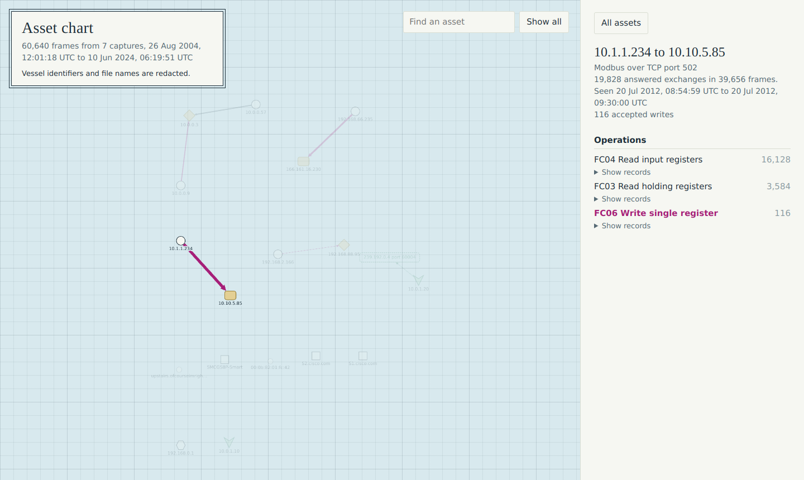

# KeelMap

Passive asset discovery for ship and port networks. Give KeelMap a packet capture and it builds an inventory of the devices on the network, where every field shows the exact frames that prove it.



## Why

Ship operators now need an inventory of onboard systems for IACS UR E26, and commercial OT visibility platforms are priced for large enterprises. Generic open-source ICS tools exist, but none focus on maritime protocols or on evidence you can check.

KeelMap is built around one rule: **report what the traffic proves, nothing more.**

- **Passive only.** It reads capture files. It never sends a packet, because active probing can disrupt fragile OT devices.
- **Evidence or unknown.** Every value cites the capture's SHA-256 and the frame numbers behind it, so you can check it in Wireshark. Missing data reads as unknown, never as a guess.
- **Conflicts are shown, not resolved.** If two frames disagree, both claims are kept.
- **Claims are kept apart from observations.** What a device says about itself is marked as self-reported. Talker ids, MAC prefixes and free-text descriptions are never upgraded into device types or vendors.
- **Safe to share by default.** Vessel identifiers and capture filenames are redacted unless you opt out.

## Install

Python 3.11 or later, no runtime dependencies.

```
git clone https://github.com/<your-account>/keelmap.git
cd keelmap
pip install .
```

## Quick start

```
keelmap scan bridge.pcapng -o inventory.json --map chart.html
```

This writes a JSON inventory and an offline HTML chart. The summary lists everything seen but not turned into evidence, so coverage gaps are never hidden.

Add network card makers with IEEE registry files you download yourself:

```
keelmap scan bridge.pcapng -o inventory.json --map chart.html --oui oui.csv --oui mam.csv --oui oui36.csv
```

Draw a chart from an existing inventory:

```
keelmap map inventory.json -o chart.html
```

`--no-redact` keeps vessel identifiers and filenames, and only writes to `*.unredacted.json` and `*.unredacted.html`, which git ignores.

## What it understands

| Protocol | What KeelMap learns |
|---|---|
| ARP | Which MAC owns which IPv4 address on the sensor's segment |
| DHCP | Client and server roles, hostnames, addresses a client is seen using |
| LLDP and LLDP-MED | Hostname, description as sent, enabled capabilities, vendor, model, firmware, serial number, MUD URL |
| Modbus/TCP | Client, server and gateway roles, unit ids, every function code used, accepted and rejected writes, device identification |
| NMEA 0183 over UDP | Talker ids, sentence types, proprietary maker codes, on any port |
| IEC 61162-450 | Senders, multicast groups, system function ids |
| AIS | Own-ship MMSI, IMO, call sign and name. Other vessels heard over radio are counted, not inventoried |
| IEEE OUI | Network card maker, from files you supply |

The full rules, including what each decoder deliberately does not store, are in [docs/decoders.md](docs/decoders.md).

## How it is validated

Every decoder is checked against an independent reference on public captures, and every difference is explained rather than tuned away.

| Area | Reference | Result |
|---|---|---|
| Modbus/TCP | tshark, 8 Zeek traces including a 60,227-frame capture and fuzzed files | 22,785 request and response pairs, all matching |
| AIS | pyais, 86,168 real sentences | 89,077 identity fields, 0 differences |
| NMEA 0183 | pynmea2 | Same sentences accepted and rejected |
| LLDP | tshark, 19 frames from tcpdump and Zeek | All accepted frames match, every discarded frame is one tshark marks malformed |
| IEEE OUI | netaddr, all 35,084 MA-L prefixes | 0 differences |
| DHCP | tshark, Wireshark's own test captures | Every value, frame and timestamp matching |

Cross-checking also found real bugs, both in KeelMap and in assumptions the references make. They are listed in the [validation log](docs/decoders.md#validation-log).

**Not yet validated: a capture from a real vessel network.** All test data is public, and some maritime captures are built from real sentences with synthetic framing. If you operate vessels or port systems and can share an authorised capture under suitable terms, please get in touch.

## The asset chart

One HTML file that opens with no network access, drawn like a nautical chart. Magenta is reserved for Modbus writes. Every value opens to the frames behind it.

Inventories carry strings from network traffic, so the chart is built to be opened safely even when a capture was crafted by an attacker. It loads nothing external, runs only scripts whose SHA-256 is pinned at render time, and places captured text without ever treating it as markup. A browser test with injected script, image and SVG payloads ships in `tools/`. Details in [docs/map.md](docs/map.md).

## Status

Version 0.1. Captures in, inventory and chart out.

Planned: S7comm and DNP3, change detection between captures, Microsoft Sentinel ingestion through a data collection rule, a live sensor mode, and an IACS UR E26 inventory report.

## Documentation

- [Precision contract](docs/precision-contract.md): what counts as evidence
- [Decoders](docs/decoders.md): per-protocol rules and the validation log
- [Data model](docs/data-model.md): the inventory format
- [Asset chart](docs/map.md): symbols, safety properties, testing

## Contributing and security

See [CONTRIBUTING.md](CONTRIBUTING.md). Report vulnerabilities privately, as described in [SECURITY.md](SECURITY.md). Never attach real captures to issues.

Only capture traffic you are authorised to capture.

## Licence

Apache License 2.0, see [LICENSE](LICENSE). Third-party material is listed in [NOTICE](NOTICE).
